<div align="center">

# 🔐 OpenVault

**Self-hostable, open source file sharing and backup.**
Your files. Your server. Your rules.

[](LICENSE)


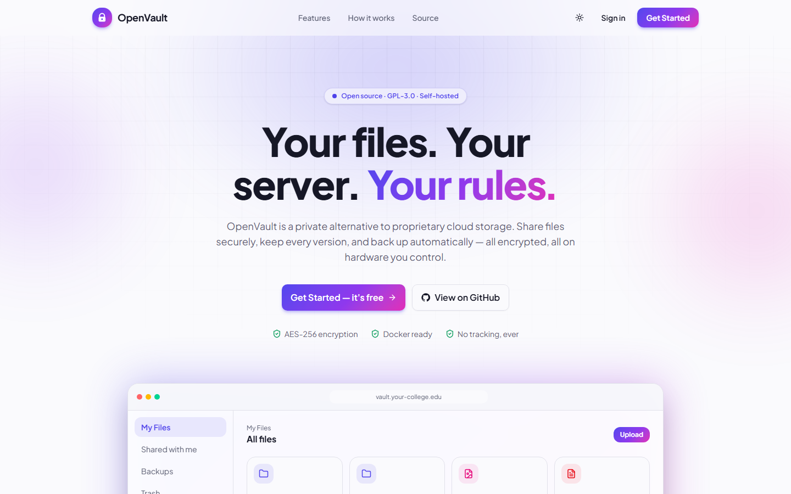

</div>

OpenVault is a web application for storing, sharing and backing up files. It is an alternative to proprietary cloud storage that you run on **your own** server: a laptop, a Raspberry Pi, a college lab machine or a cloud VM.

Every file is **encrypted at rest with AES-256-GCM** and every upload keeps a **version history**. **Scheduled backups** can be restored with one click.

> Built as a mini project for **ITL704 Recent Open Source Project Lab** (B.E. IT, Sem VII, University of Mumbai).

---

## Contents

- [Features](#-features)
- [Screenshots](#-screenshots)
- [Quick start with Docker](#-quick-start-with-docker)
- [Development setup](#-development-setup)
- [Configuration](#-configuration)
- [Running the tests](#-running-the-tests)
- [Project structure](#-project-structure)
- [API](#-api)
- [Documentation](#-documentation)
- [Roadmap](#-roadmap)
- [Contributing](#-contributing) · [License](#-license) · [Team](#-team)

---

## ✨ Features

| | Feature | Details |
|---|---|---|
| 🔐 | **Accounts** | Registration and login. Passwords are hashed with bcrypt; sessions use JWT. |
| 📁 | **Files and folders** | Upload (drag and drop anywhere, with progress), download, rename, move, nested folders, search. |
| 👀 | **Previews** | Images, PDFs, video, audio and text open in the browser, with ←/→ to browse. |
| 🗑️ | **Trash** | Restore deleted items, or delete forever. |
| 🔗 | **Share links** | Public links with an optional password and an expiry date, plus a download counter. |
| 👥 | **Share with people** | `view` or `edit` permission per user; folder shares include everything inside. |
| 🧾 | **Version history** | Every upload is a version. Restore any old one without losing history. |
| 🕒 | **Scheduled backups** | Daily or weekly encrypted snapshots of a folder (or everything). One-click restore, retention, `.zip` download. |
| 🛡️ | **Encryption at rest** | AES-256-GCM in 1 MB chunks. Tampering, reordering and truncation are detected. |
| 📊 | **Dashboard** | Storage used vs quota, storage by file type, uploads per day, activity log. |
| 🛠️ | **Admin panel** | Manage users, storage quotas, enable/disable accounts, system-wide audit log. |
| 🌗 | **Polished UI** | Light and dark mode (saved per user), responsive mobile layout, keyboard accessible. |

---

## 📸 Screenshots

| My Files (grid) | My Files (dark) |
|---|---|
| 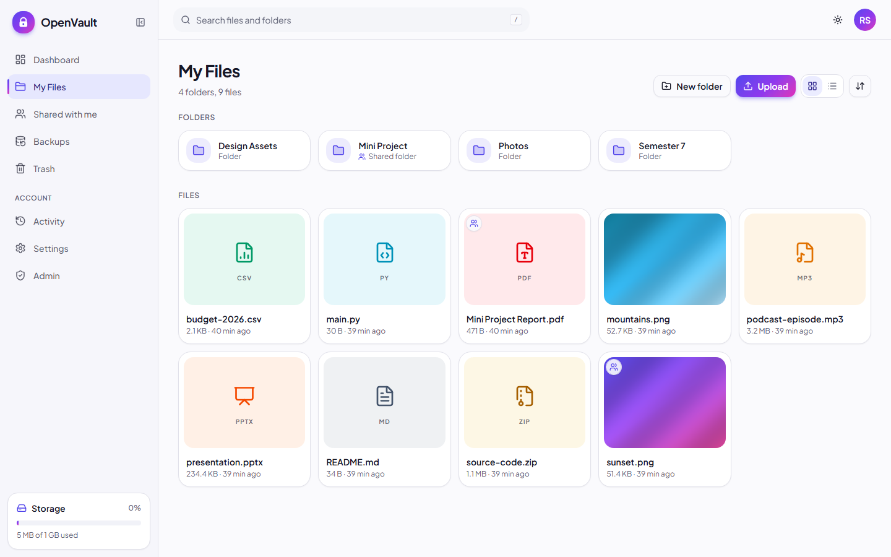 | 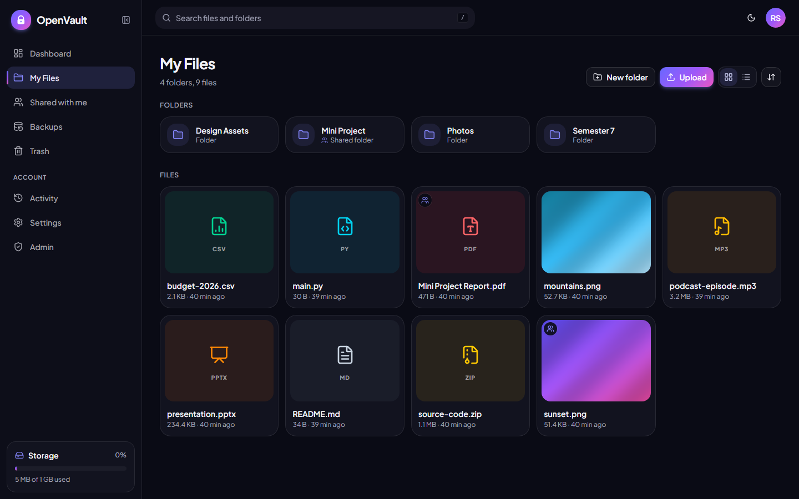 |
| **Share dialog** | **Version history** |
| 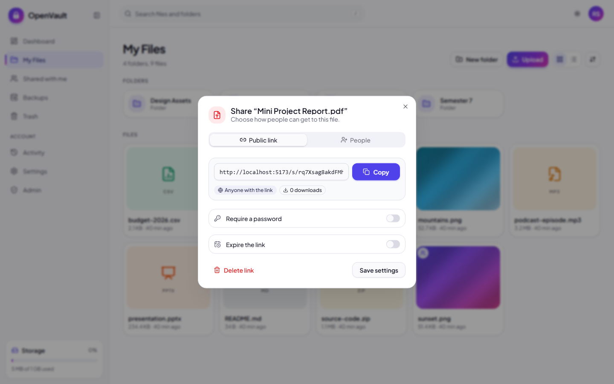 | 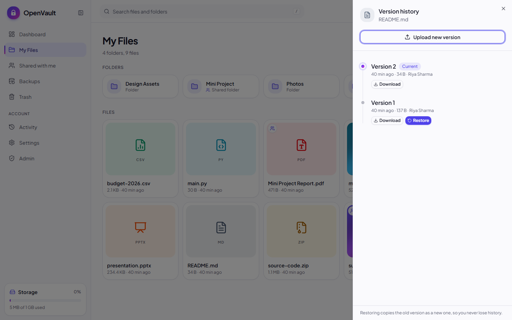 |
| **Backups** | **Dashboard** |
| 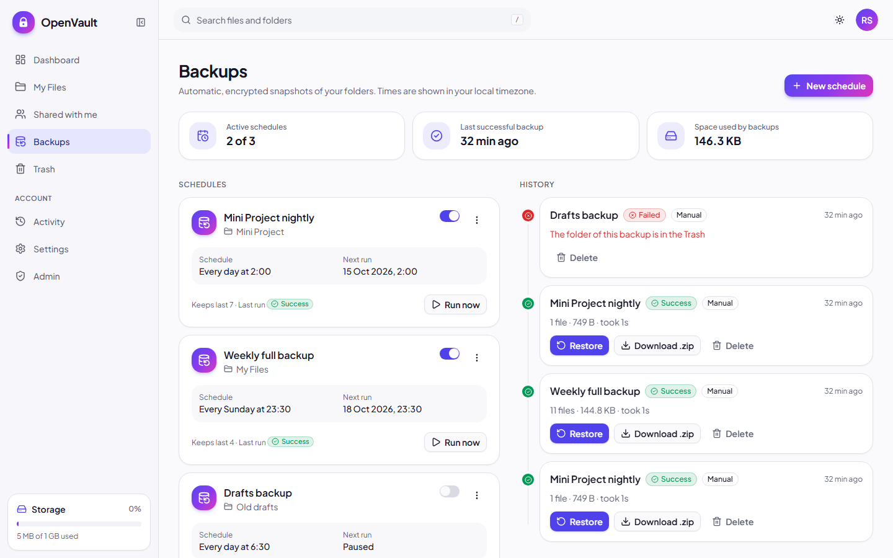 | 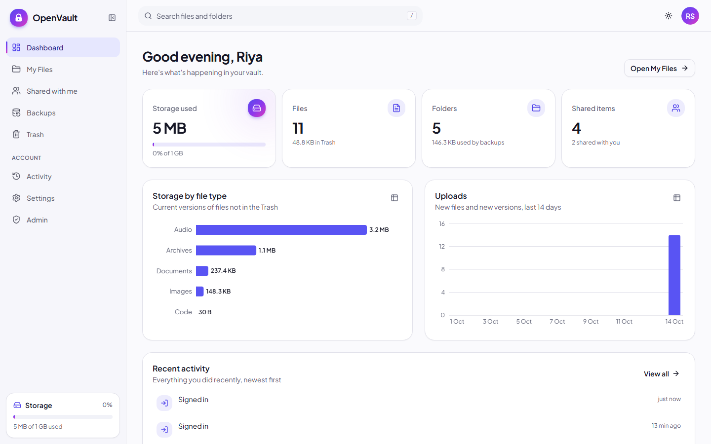 |
| **Admin panel** | **Login** |
| 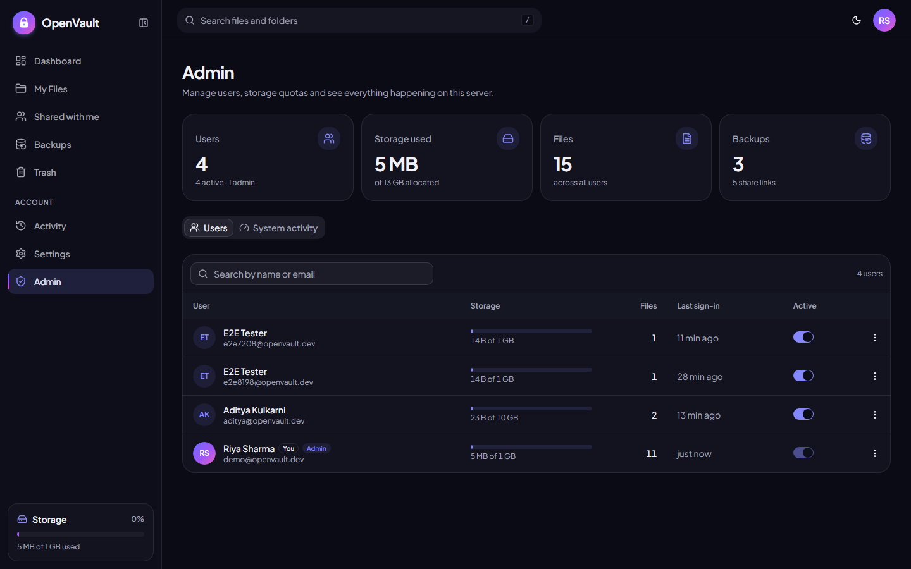 | 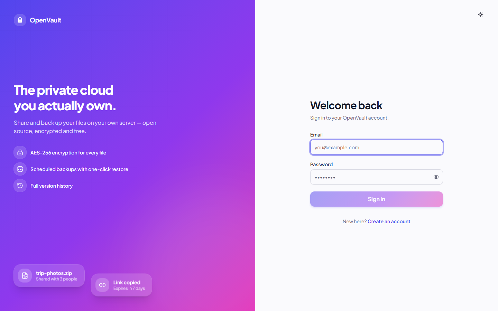 |

<p align="center">
  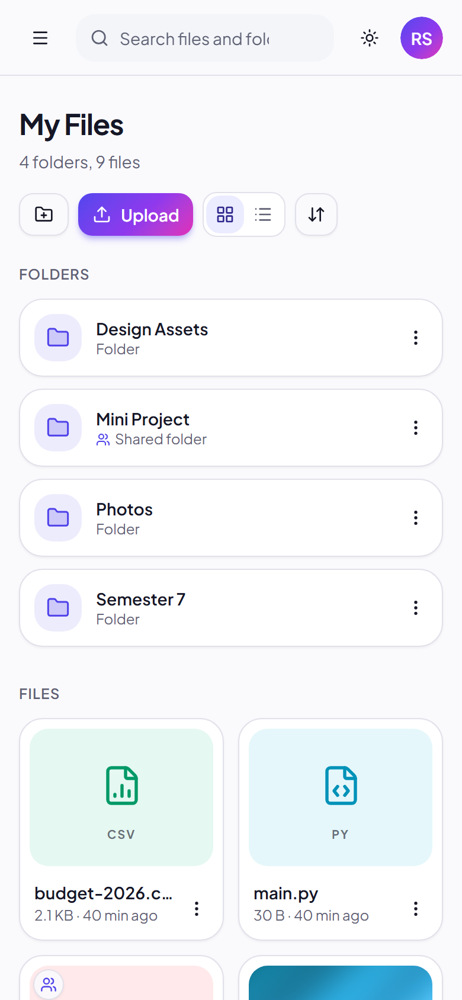
  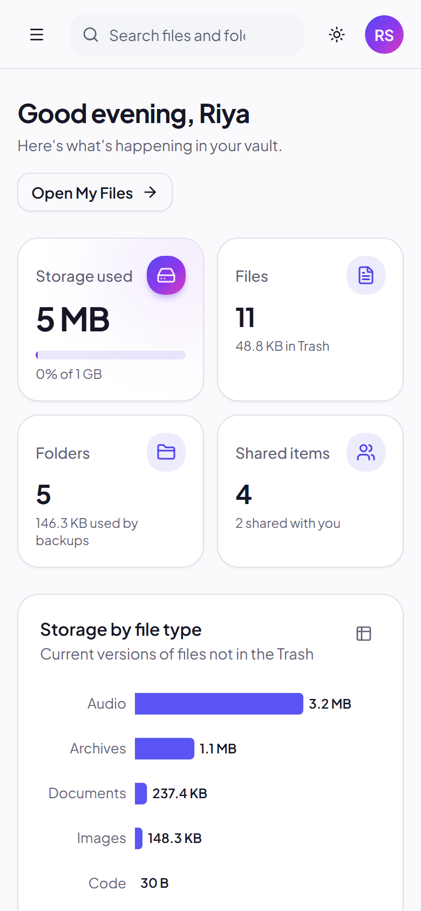
  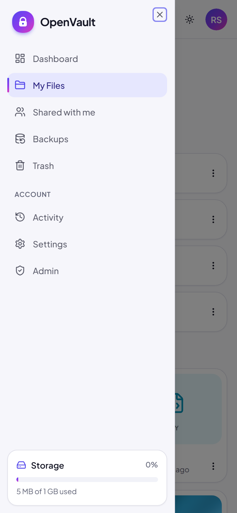
</p>

More screenshots are in [`docs/screenshots/`](docs/screenshots/).

---

## 🚀 Quick start with Docker

You need [Docker Desktop](https://www.docker.com/products/docker-desktop/) (Windows/macOS) or Docker Engine with the Compose plugin (Linux).

```bash
git clone https://github.com/<your-username>/openvault.git
cd openvault
cp .env.example .env
```

Generate the two secrets and paste them into `.env`:

```bash
python -c "import secrets; print('SECRET_KEY=' + secrets.token_urlsafe(48))"
python -c "import base64, os; print('ENCRYPTION_KEY=' + base64.b64encode(os.urandom(32)).decode())"
```

Start it:

```bash
docker compose up -d --build
```

Open **http://localhost:8080** and register. **The first account becomes the admin.**

> ⚠️ **Back up your `ENCRYPTION_KEY`.** Without it, stored files can never be decrypted.

**Using PostgreSQL instead of SQLite:** set
`DATABASE_URL=postgresql+psycopg://openvault:openvault@db:5432/openvault` in `.env` and run
`docker compose --profile postgres up -d --build`.

All data (database, encrypted files, backups) lives in the `openvault-data` Docker volume.

---

## 🛠️ Development setup

Requirements: **Python 3.12+** and **Node.js 22+**.

```bash
cp .env.example .env            # then set SECRET_KEY and ENCRYPTION_KEY (see above)

# Backend: http://localhost:8000 (API docs at /docs)
cd backend
python -m venv .venv
.venv\Scripts\activate          # Windows   |   source .venv/bin/activate   (Linux/macOS)
pip install -r requirements-dev.txt
uvicorn app.main:app --reload

# Frontend: http://localhost:5173 (in a second terminal)
cd frontend
npm install
npm run dev
```

The Vite dev server forwards `/api` to the backend, so open **http://localhost:5173**.

---

## ⚙️ Configuration

All settings come from environment variables (or `.env`). See [`.env.example`](.env.example).

| Variable | Default | Description |
|---|---|---|
| `SECRET_KEY` | **required** | Signs login tokens. Random, at least 16 characters. |
| `ENCRYPTION_KEY` | **required** | Base64 of 32 random bytes: the AES-256 key for stored files. |
| `DATABASE_URL` | `sqlite:///./data/openvault.db` | Any SQLAlchemy URL; PostgreSQL is supported. |
| `STORAGE_DIR` | `./data/storage` | Where encrypted blobs and backups are stored. |
| `ADMIN_EMAIL` | (empty) | This email also becomes admin when it registers. |
| `DEFAULT_QUOTA_MB` | `1024` | Storage quota for new users. |
| `MAX_UPLOAD_MB` | `100` | Largest single upload. |
| `MAX_VERSIONS` | `10` | Old versions kept per file. |
| `ACCESS_TOKEN_EXPIRE_MINUTES` | `60` | Login session length. |
| `FILE_LINK_EXPIRE_MINUTES` | `5` | Lifetime of preview/download links. |
| `ENABLE_SCHEDULER` | `true` | Run scheduled backups. |

The server **refuses to start** if `SECRET_KEY` or `ENCRYPTION_KEY` are missing or weak.

---

## ✅ Running the tests

```bash
cd backend
pytest            # 113 tests: auth, encryption, files, sharing, versions, backups, admin…

cd frontend
npm run lint
npm run build
```

Tests use a temporary database and storage folder, so they never touch your data. GitHub Actions runs the same checks, plus the Docker image builds, on every push ([`.github/workflows/ci.yml`](.github/workflows/ci.yml)).

---

## 🗂️ Project structure

```
openvault/
├── backend/                 FastAPI + SQLAlchemy + APScheduler
│   ├── app/
│   │   ├── main.py          app setup, routers, scheduler start/stop
│   │   ├── config.py        settings from .env (validated)
│   │   ├── models.py        9 database tables
│   │   ├── schemas.py       request/response models
│   │   ├── security.py      bcrypt, JWT, auth dependencies
│   │   ├── scheduler.py     APScheduler ↔ backup_jobs table
│   │   ├── routers/         auth, users, folders, files, trash, shares,
│   │   │                    public, backups, dashboard, admin
│   │   ├── services/        file_service, access, share_service,
│   │   │                    backup_service, quota, activity, stats
│   │   └── storage/         base (interface), local, crypto (AES-GCM)
│   ├── tests/               pytest suite
│   └── Dockerfile
├── frontend/                React (Vite) + Tailwind + shadcn/ui
│   ├── src/
│   │   ├── pages/           Landing, Login, Files, Shared, Backups, Trash,
│   │   │                    Dashboard, Activity, Admin, Settings, PublicShare…
│   │   ├── components/      layout, files/, charts/, backups/, ui/ (shadcn)
│   │   ├── context/         Auth, Theme, Upload queue
│   │   ├── hooks/           useItemActions (all file actions + dialogs)
│   │   └── lib/             api client, formatting, file types, schedules
│   ├── nginx.conf
│   └── Dockerfile
├── docs/                    architecture, Gantt, logbook, report outline, viva
├── docker-compose.yml
└── .env.example
```

---

## 🔌 API

The backend documents itself. Run it and open **http://localhost:8000/docs** (Swagger UI) or `/redoc`.

| Area | Main endpoints |
|---|---|
| Auth | `POST /api/auth/register`, `POST /api/auth/login`, `GET /api/auth/me` |
| Files | `POST /api/files/upload`, `PATCH/DELETE /api/files/{id}`, `POST /api/files/{id}/links`, `GET /api/files/search` |
| Folders | `GET /api/folders/contents`, `POST /api/folders`, `PATCH/DELETE /api/folders/{id}` |
| Versions | `GET /api/files/{id}/versions`, `POST /api/files/{id}/versions/{vid}/restore` |
| Trash | `GET /api/trash`, `DELETE /api/trash`, `POST …/{id}/restore` |
| Sharing | `/api/shares/links`, `/api/shares/users`, `GET /api/shares/with-me`, `GET /api/public/s/{token}` |
| Backups | `/api/backups/jobs`, `POST /api/backups/jobs/{id}/run`, `/api/backups/runs`, `POST /api/backups/runs/{id}/restore` |
| Dashboard | `GET /api/dashboard`, `GET /api/activity` |
| Admin | `GET /api/admin/stats`, `/api/admin/users`, `GET /api/admin/activity` |

---

## 📚 Documentation

| Document | Contents |
|---|---|
| [`docs/architecture.md`](docs/architecture.md) | System architecture, ER, use-case and data-flow diagrams, backup/upload/auth sequences, security design |
| [`docs/gantt.md`](docs/gantt.md) | 12-week Gantt chart and work split for 4 members |
| [`docs/logbook.md`](docs/logbook.md) | Weekly logbook template with sample entries |
| [`docs/report-outline.md`](docs/report-outline.md) | University of Mumbai report structure, chapter by chapter |
| [`docs/viva.md`](docs/viva.md) | 25 likely viva questions answered from the code |

---

## 🧭 Roadmap

- [ ] MinIO / S3 storage backend (the `StorageBackend` interface is ready)
- [ ] Two-factor authentication and login rate limiting
- [ ] End-to-end (client-side) encryption
- [ ] Desktop / mobile sync clients
- [ ] Alembic database migrations
- [ ] Incremental, deduplicated backups

Ideas and pull requests are welcome!

---

## 🤝 Contributing

Contributions are welcome. Please read [CONTRIBUTING.md](CONTRIBUTING.md) and follow our [Code of Conduct](CODE_OF_CONDUCT.md). Use the issue templates to report bugs or request features. For security problems, contact the maintainers privately (see [SECURITY.md](SECURITY.md)).

## 📄 License

OpenVault is free software: you can redistribute it and/or modify it under the terms of the **GNU General Public License v3.0**. See [LICENSE](LICENSE).

## 👥 Team

ITL704 Recent Open Source Project Lab, B.E. Information Technology, Semester VII, University of Mumbai (2026–27).

| Member | Roll no. | Role |
|---|---|---|
| _Name_ | | Backend core & security |
| _Name_ | | Storage, encryption & backups |
| _Name_ | | Frontend |
| _Name_ | | Sharing, QA, DevOps & documentation |

**Guide:** _Prof. Name_

## 🙏 Acknowledgements

Built with [FastAPI](https://fastapi.tiangolo.com), [SQLAlchemy](https://www.sqlalchemy.org), [APScheduler](https://apscheduler.readthedocs.io), [cryptography](https://cryptography.io), [React](https://react.dev), [Vite](https://vite.dev), [Tailwind CSS](https://tailwindcss.com), [shadcn/ui](https://ui.shadcn.com), [Framer Motion](https://motion.dev), [Lucide](https://lucide.dev) and [Recharts](https://recharts.org).
