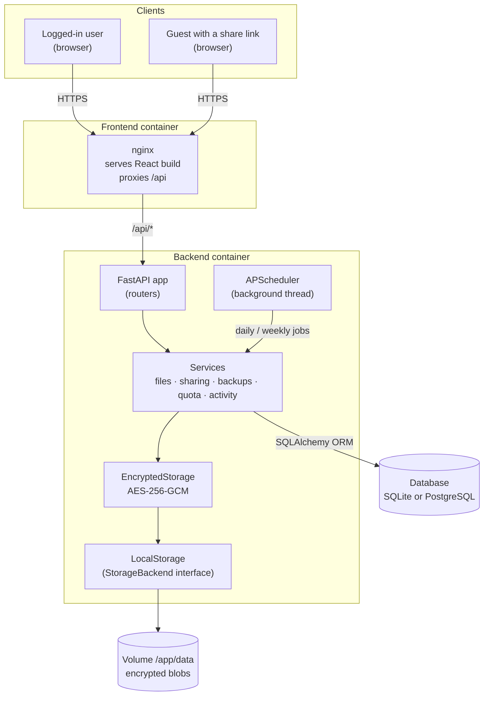
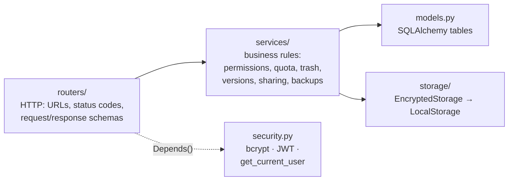
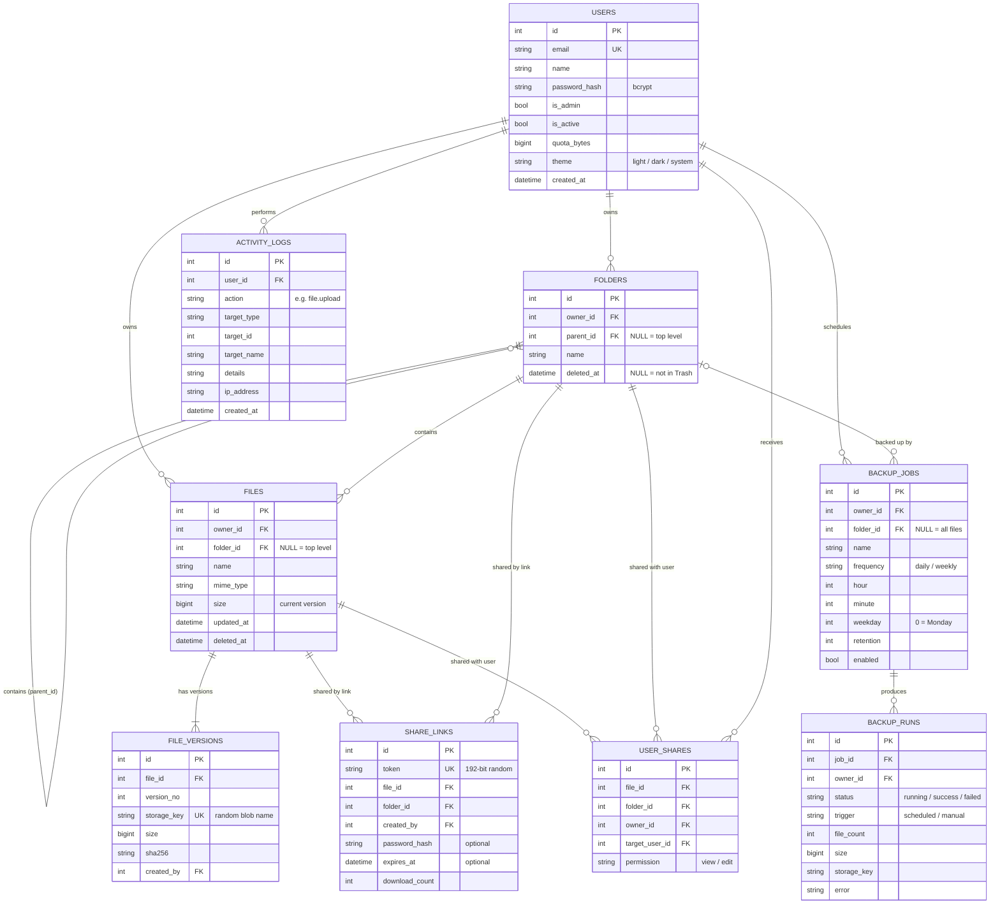
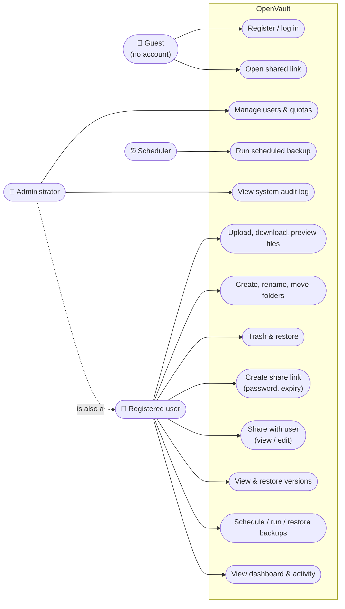
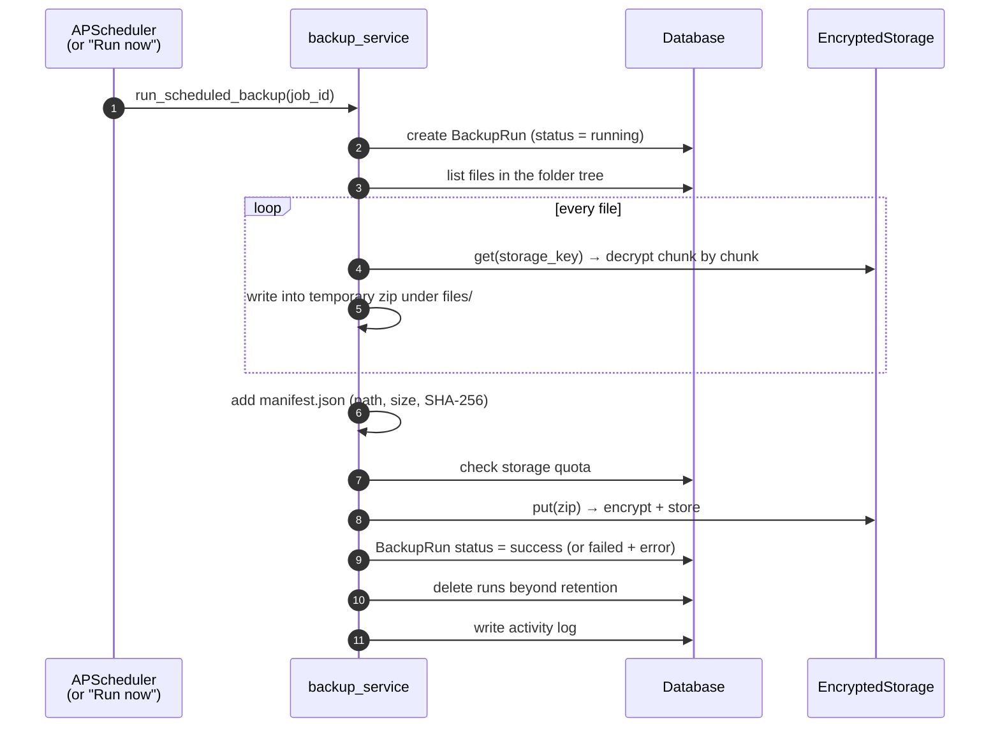
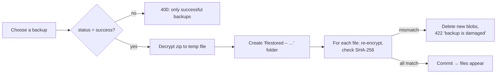
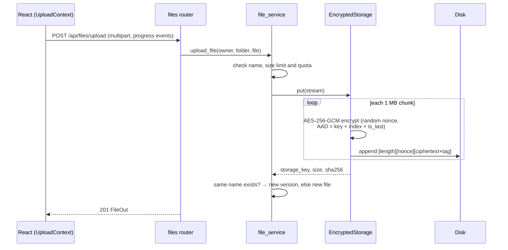
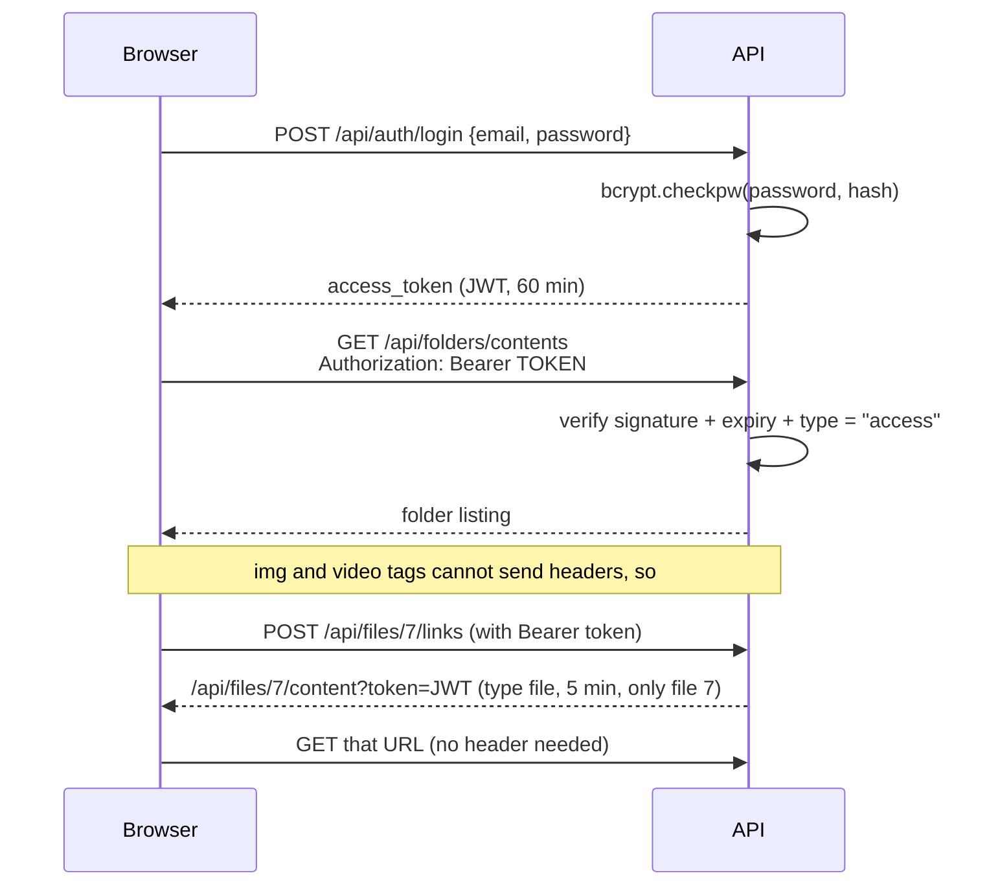
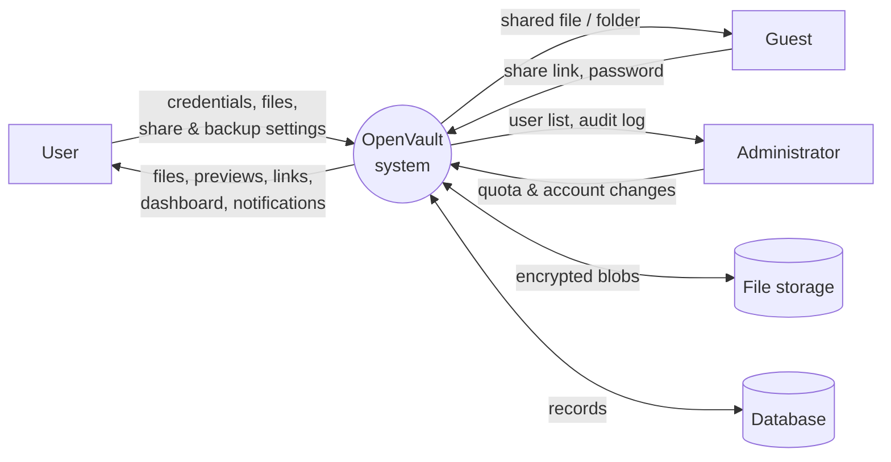
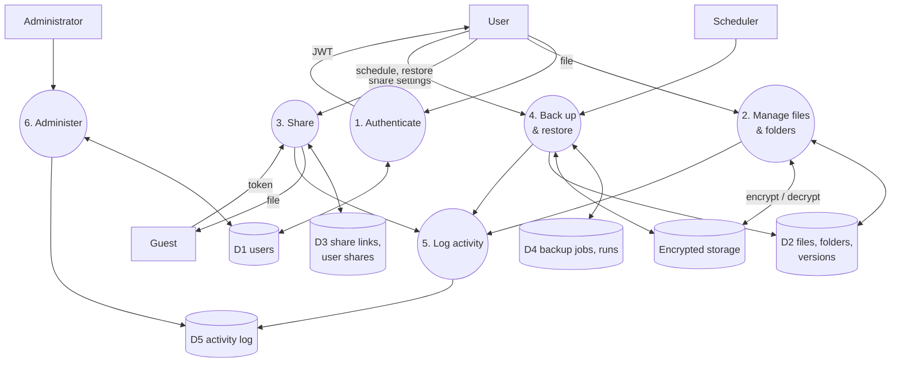

# OpenVault: architecture

This document explains how OpenVault is built. The diagrams are written in [Mermaid](https://mermaid.js.org/), which GitHub renders automatically.

- [1. System architecture](#1-system-architecture)
- [2. Backend layers](#2-backend-layers)
- [3. Database design (ER diagram)](#3-database-design-er-diagram)
- [4. Use-case diagram](#4-use-case-diagram)
- [5. Backup flow](#5-backup-flow)
- [6. Upload and encryption flow](#6-upload-and-encryption-flow)
- [7. Authentication and download links](#7-authentication-and-download-links)
- [8. Security design summary](#8-security-design-summary)
- [9. Technology choices](#9-technology-choices)
- [10. Data flow diagrams](#10-data-flow-diagrams)

---

## 1. System architecture

OpenVault is a **REST API plus single-page application**. The browser loads a React app, which talks to a FastAPI backend over JSON. In production (Docker), **nginx** serves the React files and forwards `/api/*` to the backend, so the browser only ever talks to one origin.



| Part | Technology | Responsibility |
|---|---|---|
| Frontend | React (Vite), Tailwind, shadcn/ui | All screens; talks to the API with axios |
| Reverse proxy | nginx | Serves static files, forwards `/api`, streams uploads |
| API | FastAPI | Validates requests (Pydantic), checks auth, calls services |
| Scheduler | APScheduler | Runs backup jobs at their scheduled time |
| Storage | `StorageBackend` + `EncryptedStorage` | Stores every file encrypted; MinIO/S3 can be added later |
| Database | SQLAlchemy → SQLite / PostgreSQL | Users, files, versions, shares, backups, activity log |

---

## 2. Backend layers

Each layer only talks to the layer below it. This keeps routes short and makes the logic easy to test.



| Folder / file | What it contains |
|---|---|
| `app/config.py` | Settings read from `.env` (refuses weak or missing secrets) |
| `app/models.py` | The 9 database tables |
| `app/schemas.py` | Request/response shapes (no password hashes can leak) |
| `app/security.py` | Password hashing, JWT creation/verification, auth dependencies |
| `app/routers/` | `auth`, `users`, `folders`, `files`, `trash`, `shares`, `public`, `backups`, `dashboard`, `admin` |
| `app/services/` | `file_service`, `access` (permissions), `share_service`, `backup_service`, `quota`, `activity`, `stats` |
| `app/storage/` | `base.py` (interface), `local.py` (disk), `crypto.py` (AES-GCM) |
| `app/scheduler.py` | Starts APScheduler and keeps it in sync with the `backup_jobs` table |

---

## 3. Database design (ER diagram)



**Design notes**
- **Soft delete:** "Move to Trash" only sets `deleted_at`. Trashing a folder stamps the *same* time on everything inside, so Restore brings back exactly that group.
- **Current version:** there is no `current_version_id` column. The current version is simply the one with the highest `version_no`, which avoids a circular foreign key.
- **Cascades:** every `owner_id` foreign key uses `ON DELETE CASCADE`, so deleting a user removes all of their rows. Their encrypted blobs are removed from disk after the commit.
- **Times** are stored as UTC.

---

## 4. Use-case diagram

Mermaid has no UML use-case diagram, so actors and use cases are drawn as a flowchart.



---

## 5. Backup flow



**Restore:** decrypt the zip into a temporary file, create a new top-level folder `Restored – <job> – <date>`, re-encrypt every file as a new blob, and compare its SHA-256 with the manifest. If any checksum differs, the restore is cancelled and every blob created so far is deleted. Existing files are never overwritten.



---

## 6. Upload and encryption flow



**Encrypted file format (one record per 1 MB chunk):**

```
[4-byte length L][12-byte random nonce][L bytes: ciphertext + 16-byte GCM tag]
```

The *associated data* of each chunk is `storage_key + chunk index + is_last flag`. Changing a byte, swapping chunks between files, reordering chunks or cutting the file short all make decryption fail. Each case has a test in `tests/test_crypto.py`.

---

## 7. Authentication and download links



| Token type | Lifetime | Used for |
|---|---|---|
| `access` | 60 min | Every API call of a logged-in user |
| `file` | 5 min | One file's preview/download URL |
| `backup` | 5 min | Downloading one backup .zip |
| `share` | 60 min | Unlocking one password-protected link (dies when the password changes) |

---

## 8. Security design summary

| Threat | Protection |
|---|---|
| Stolen database | Passwords are bcrypt hashes (salted, slow) |
| Stolen disk / server backups | Files are AES-256-GCM encrypted at rest; the key lives only in `.env` |
| Tampered stored files | GCM authentication tag, plus chunks bound to their file and position |
| Guessing share links | 192-bit random tokens (`secrets.token_urlsafe(24)`) |
| Brute-forcing link passwords | bcrypt makes each guess slow; links can expire |
| Reading other users' files | Every route checks `owner / edit / view` (`services/access.py`) and returns 404 for no access |
| Stored XSS via uploaded HTML/SVG | Shown as text or download only, with `X-Content-Type-Options: nosniff` |
| Path traversal in storage | Blob names must be 32 hex characters; user file names never reach the disk |
| Account enumeration | Same error and same bcrypt timing for wrong email and wrong password |
| Weak deployment secrets | The server refuses to start with placeholder or short keys |
| Admin lockout | Admins cannot disable, demote or delete themselves |

---

## 9. Technology choices

| Need | Chosen | Why (vs. alternatives) |
|---|---|---|
| Web framework | **FastAPI** | Automatic validation and API docs at `/docs`; faster to build than Django REST for an API-only backend |
| ORM | **SQLAlchemy 2.0** | Same code on SQLite (development) and PostgreSQL (production) |
| Scheduler | **APScheduler** | Runs inside the API process; Celery + Redis would add two more services for little gain at this scale |
| Encryption | **AES-256-GCM** (`cryptography`) | Authenticated encryption detects tampering; AES-CBC alone would not |
| Passwords | **bcrypt** | Purpose-built slow hash with salt; SHA-256 is too fast for passwords |
| Frontend | **React + Vite** | Component model, fast dev server; shadcn/ui gives accessible components we own the code of |
| Deployment | **Docker Compose** | One command to run nginx + API (+ PostgreSQL) anywhere |

---

## 10. Data flow diagrams

**Level 0 (context diagram):** OpenVault as one process and the outside entities it exchanges data with.



**Level 1:** the main processes inside the system.

