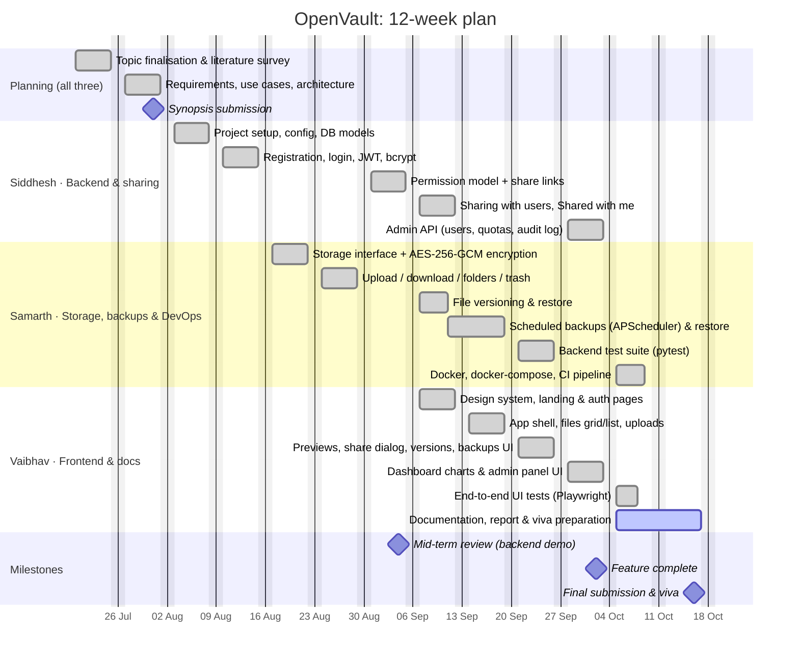

# Project plan: 12-week Gantt chart

**Project:** OpenVault, a file sharing and backup application
**Course:** ITL704 Recent Open Source Project Lab, Sem VII (IT), University of Mumbai
**Team:** 3 members

| Member | Roll no. | Main responsibility | Also helps with |
|---|---|---|---|
| **Siddhesh Dalvi** | 776 | Backend core: database models, authentication (bcrypt + JWT), permission model, **sharing** (links + user shares), admin API | Code reviews, security Q&A for the viva |
| **Samarth Jedhe** | 775 | Storage and encryption (AES-GCM), file/folder API, versioning, backups and scheduler, **backend test suite, Docker + CI** | Open source files, `.env` configuration |
| **Vaibhav Narayankar** | 777 | Frontend: design system, app layout, files UI, previews, dashboard charts, **end-to-end UI tests, documentation and report** | Logbook, screenshots |

## Week-by-week summary

| Week | Dates (2026) | Goal | Owner(s) |
|---|---|---|---|
| 1 | 20–24 Jul | Topic, literature survey of Drive / Dropbox / Nextcloud / Seafile | All |
| 2 | 27–31 Jul | Requirements, architecture, ER and use-case diagrams, synopsis | All |
| 3 | 3–7 Aug | Repo setup, config, database models | Siddhesh |
| 4 | 10–14 Aug | Authentication (bcrypt, JWT), first tests | Siddhesh, Samarth |
| 5 | 17–21 Aug | Storage interface + AES-GCM encryption | Samarth |
| 6 | 24–28 Aug | Upload/download, folders, trash | Samarth |
| 7 | 31 Aug–4 Sep | Permission model, share links; **mid-term demo** | Siddhesh |
| 8 | 7–11 Sep | Sharing with users; versioning; frontend design system and auth pages | Siddhesh, Samarth, Vaibhav |
| 9 | 14–18 Sep | Scheduled backups; app shell and files UI | Samarth, Vaibhav |
| 10 | 21–25 Sep | Previews, share dialog, backups UI; backend test suite | Vaibhav, Samarth |
| 11 | 28 Sep–2 Oct | Dashboard, activity log, admin panel | Siddhesh, Vaibhav |
| 12 | 5–16 Oct | Docker, CI, end-to-end tests, docs, report, viva preparation, **submission** | Samarth, Vaibhav (+ all) |

> Adjust the dates to your semester calendar. In Mermaid, changing the first date of a task moves it, and `after <id>` keeps dependent tasks in order.
