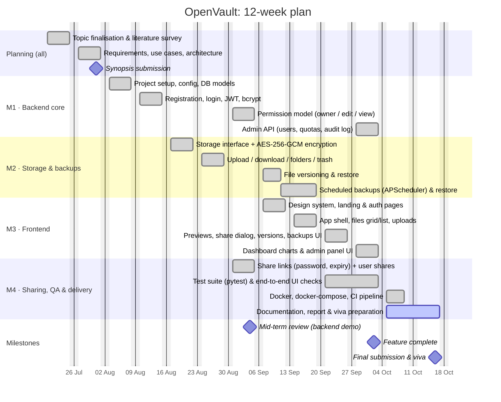

# Project plan: 12-week Gantt chart

**Project:** OpenVault, a file sharing and backup application
**Course:** ITL704 Recent Open Source Project Lab, Sem VII (IT), University of Mumbai
**Team:** 4 members (replace the placeholders with your names and roll numbers)

| Member | Main responsibility | Also helps with |
|---|---|---|
| **M1**: _Name (Roll no.)_ | Backend core: database models, authentication (bcrypt + JWT), security, admin API | Code reviews, viva Q&A on security |
| **M2**: _Name (Roll no.)_ | Storage and encryption (AES-GCM), file/folder API, versioning, backups and scheduler | Backend tests |
| **M3**: _Name (Roll no.)_ | Frontend: design system, app layout, files UI, previews, dashboard charts | UI screenshots for the report |
| **M4**: _Name (Roll no.)_ | Sharing (API + UI), testing and QA, Docker + CI, documentation and report | Project management, logbook |

## Week-by-week summary

| Week | Dates (2026) | Goal | Owner(s) |
|---|---|---|---|
| 1 | 20–24 Jul | Topic, literature survey of Drive / Dropbox / Nextcloud / Seafile | All |
| 2 | 27–31 Jul | Requirements, architecture, ER and use-case diagrams, synopsis | All |
| 3 | 3–7 Aug | Repo setup, config, database models | M1 |
| 4 | 10–14 Aug | Authentication (bcrypt, JWT), first tests | M1 |
| 5 | 17–21 Aug | Storage interface + AES-GCM encryption | M2 |
| 6 | 24–28 Aug | Upload/download, folders, trash | M2 |
| 7 | 31 Aug–4 Sep | Sharing: links + users; permission model; **mid-term demo** | M4, M1 |
| 8 | 7–11 Sep | Versioning; frontend design system and auth pages | M2, M3 |
| 9 | 14–18 Sep | Scheduled backups; app shell and files UI | M2, M3 |
| 10 | 21–25 Sep | Previews, share dialog, backups UI; test suite | M3, M4 |
| 11 | 28 Sep–2 Oct | Dashboard, activity log, admin panel | M1, M3 |
| 12 | 5–16 Oct | Docker, CI, docs, report, viva preparation, **submission** | M4 (+ all) |

> Adjust the dates to your semester calendar. In Mermaid, changing the first date of a task moves it, and `after <id>` keeps dependent tasks in order.
